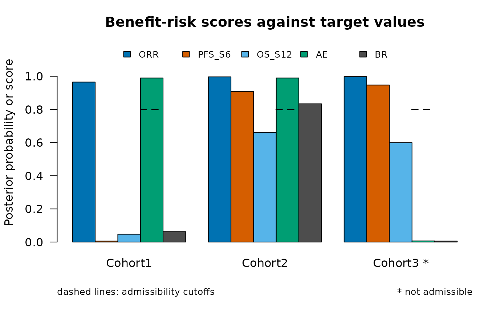
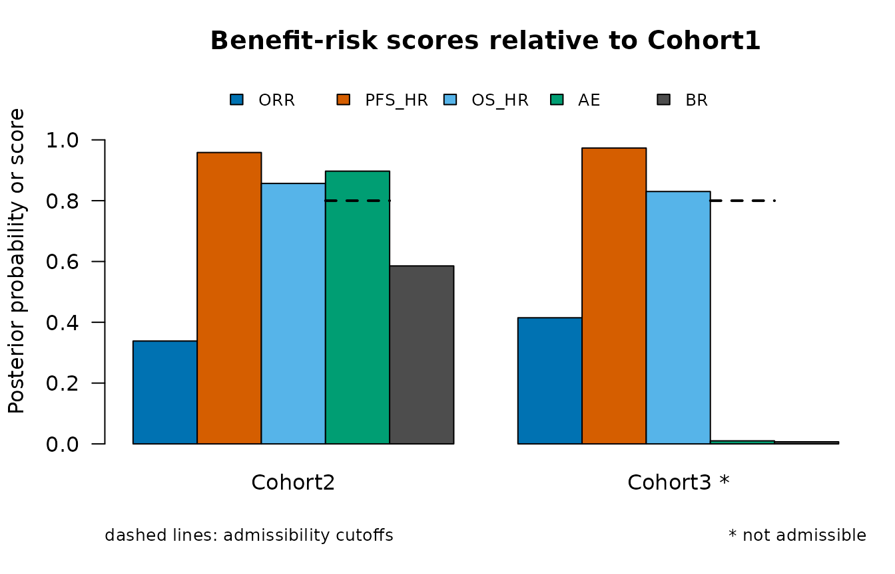

# Posterior benefit-risk score

``` r

library(OncoCohortSelect)
```

The posterior benefit-risk score of Chakraborty et al. (2026) summarizes
several efficacy and safety endpoints of a cohort by posterior
probabilities that each endpoint is favorable. This article describes
the models, the components of the score and their combination, and the
two ways of using the score: against target values and relative to a
reference cohort.

## Models

A binary endpoint, such as objective response or an adverse event, has a
rate \\p\\ with a beta prior \\\mathrm{Beta}(a_0, b_0)\\. With \\x\\
patients with the event among \\n\\ evaluable patients, the posterior is
\\\mathrm{Beta}(a_0 + x, b_0 + n - x)\\. Patients with a missing value
are not counted.

For a time-to-event endpoint, such as progression-free survival (PFS) or
overall survival (OS), the event times are taken as exponential with
hazard \\\lambda\\, which has a gamma prior with shape \\a_0\\ and rate
\\b_0\\. With \\d\\ events and a total follow-up time \\T\\, the
posterior is \\\mathrm{Gamma}(a_0 + d, b_0 + T)\\. The parameter of
interest is the survival probability at a time \\t\\, \\S(t) =
\exp(-\lambda t)\\, or the hazard ratio \\\lambda /
\lambda\_{\mathrm{ref}}\\ of a cohort against a reference cohort. The
exponential model makes the posterior available in closed form; it
describes the survival probability at the chosen time and the overall
hazard, not the shape of the survival curve.

The default priors are \\\mathrm{Beta}(0.5, 0.5)\\ and
\\\mathrm{Gamma}(0.5, 0)\\, which carry little information. Other priors
are set by the columns `prior.a` and `prior.b` of the criteria.

## Components

Each component \\S_k\\ is the posterior probability that the parameter
of an endpoint is favorable.
[`PosteriorProb()`](https://gosukehommaEX.github.io/OncoCohortSelect/reference/PosteriorProb.md)
computes it from the posterior parameters. With 18 responders among 40
patients, the probability that the response rate is at least 0.3 is

``` r

PosteriorProb("rate", a = 0.5 + 18, b = 0.5 + 22, target = 0.3)
#> [1] 0.9780309
pbeta(0.3, 0.5 + 18, 0.5 + 22, lower.tail = FALSE)
#> [1] 0.9780309
```

and with 20 events in 300 months of follow-up, the probability that the
survival probability at month 6 is at least 0.5 is

``` r

PosteriorProb("surv", a = 0.5 + 20, b = 300, target = 0.5, time = 6)
#> [1] 0.996266
```

Since \\S(6) \ge 0.5\\ is equivalent to \\\lambda \le -\log(0.5) / 6\\,
this is a gamma probability. For an endpoint whose lower values are
favorable, such as an adverse event, the component is the probability
that the rate is at most the target.

## Composite score and admissibility

The composite score of a cohort is

\\\mathrm{BR} = \prod\_{k = 1}^{K} S_k^{w_k},\\

with weights \\w_k\\ that are \\1 / K\\ by default, which makes the
score the geometric mean of the components. A small component lowers the
score more than in an arithmetic mean, so a clearly unfavorable endpoint
is compensated less by the others. The score of Chakraborty et
al. (2026), the geometric mean of the efficacy components times the
geometric mean of the safety components, is obtained with weights \\1 /
K\_{\mathrm{eff}}\\ for the efficacy components and \\1 /
K\_{\mathrm{saf}}\\ for the safety components.

A component can also have a cutoff: a cohort is admissible only when
every such component reaches its cutoff. Without a reference cohort, the
admissible cohort with the highest score is marked as selected.

## Scores against target values

The data of one simulated trial with three cohorts of 50 patients
illustrate the score. Cohort1 is the reference regimen. Cohort2 and
Cohort3 are more active, and Cohort3 has many more adverse events (a
true rate of 0.5 against 0.15).

``` r

make_arm <- function(pfs, orr, os) {
  CorOncoEndpoints::OncoArm(pfs.median = pfs, orr = orr, resp.cor = 0.4,
                            death.prop = 0.15, os.median = os)
}
arms <- list(Cohort1 = make_arm(5, 0.30, 14), Cohort2 = make_arm(8, 0.50, 20),
             Cohort3 = make_arm(9, 0.55, 21))
d <- SimCohorts(nsim = 1, n = c(50, 50, 50), arms = arms, ae.rate = c(0.15, 0.15, 0.50),
                cutoff = 24, a.time = c(0, 12), seed = 11)
eps <- list(
  Endpoint("OS", "tte", time = "os_tte", event = "os_event"),
  Endpoint("PFS", "tte", time = "pfs_tte", event = "pfs_event"),
  Endpoint("ORR", "binary", var = "response"),
  Endpoint("AE", "binary", var = "ae", higher.better = FALSE))
```

The criteria have one row per component. The efficacy components get
weights of 1/3 and the safety component a weight of 1, and the adverse
event rate must be at most 0.35 with a posterior probability of at least
0.8.

``` r

crit <- data.frame(endpoint = c("ORR", "PFS", "OS", "AE"),
                   target = c(0.30, 0.50, 0.60, 0.35),
                   time = c(NA, 6, 12, NA),
                   weight = c(1 / 3, 1 / 3, 1 / 3, 1),
                   cutoff = c(NA, NA, NA, 0.8))
br <- BenefitRisk(d, eps, crit)
br
#> Posterior benefit-risk scores against target values
#> 
#>  component definition      weight cutoff
#>  ORR       P(rate >= 0.3)  0.333        
#>  PFS_S6    P(S(6) >= 0.5)  0.333        
#>  OS_S12    P(S(12) >= 0.6) 0.333        
#>  AE        P(rate <= 0.35) 1      0.8   
#> 
#>    group   ORR  PFS_S6 OS_S12      AE admissible      BR selected
#>  Cohort1 0.965 0.00564 0.0472 0.98949       TRUE 0.06286    FALSE
#>  Cohort2 0.996 0.90879 0.6613 0.98949       TRUE 0.83399     TRUE
#>  Cohort3 0.998 0.94723 0.5995 0.00682      FALSE 0.00564    FALSE
#> 
#> Selected: Cohort2
```

The column `ORR` is \\P(p \ge 0.3)\\, `PFS_S6` is \\P(S(6) \ge 0.5)\\
for PFS, `OS_S12` is \\P(S(12) \ge 0.6)\\ for OS and `AE` is \\P(p \le
0.35)\\ for the adverse event. Cohort3 has an `AE` component of 0.01 and
is not admissible. The selected cohort is Cohort2.

The printed result lists the definition, weight and cutoff of each
component before the scores.
[`plot()`](https://rdrr.io/r/graphics/plot.default.html) shows the
components and the score of each cohort; the dashed lines are the
admissibility cutoffs, and an asterisk marks a cohort that is not
admissible.

``` r

plot(br)
```



A component against a fixed target measures how certainly a cohort
exceeds the target, not by how much. When several cohorts clearly exceed
all targets, their components are all close to 1 and the scores separate
them little. The targets should therefore be values that discriminate
between the cohorts, such as the values expected for the reference
regimen.

## Scores relative to a reference cohort

With a reference cohort, each component compares a cohort with the
reference: the probability that the difference of the rates or of the
survival probabilities at a time is at least a margin (at most a margin
for an endpoint whose lower values are favorable), or that the hazard
ratio is at most a bound. The posterior distributions of the two cohorts
are independent. The probability of a difference is computed by
numerical integration, and that of the hazard ratio from the F
distribution, since \\(\lambda b / a) / (\lambda\_{\mathrm{ref}}
b\_{\mathrm{ref}} / a\_{\mathrm{ref}})\\ follows an F distribution with
\\2a\\ and \\2a\_{\mathrm{ref}}\\ degrees of freedom for gamma
posteriors with shapes \\a, a\_{\mathrm{ref}}\\ and rates \\b,
b\_{\mathrm{ref}}\\.

``` r

crit_ref <- data.frame(endpoint = c("ORR", "PFS", "OS", "AE"),
                       measure = c("rate", "hr", "hr", "rate"),
                       target = c(0.10, 0.80, 0.90, 0.10),
                       weight = c(1 / 3, 1 / 3, 1 / 3, 1),
                       cutoff = c(NA, NA, NA, 0.8))
br_ref <- BenefitRisk(d, eps, crit_ref, reference = "Cohort1")
br_ref
#> Posterior benefit-risk scores relative to Cohort1
#> 
#>  component definition                weight cutoff
#>  ORR       P(rate - rate_ref >= 0.1) 0.333        
#>  PFS_HR    P(HR <= 0.8)              0.333        
#>  OS_HR     P(HR <= 0.9)              0.333        
#>  AE        P(rate - rate_ref <= 0.1) 1      0.8   
#> 
#>    group reference   ORR PFS_HR OS_HR      AE admissible      BR
#>  Cohort2   Cohort1 0.338  0.958 0.857 0.89716       TRUE 0.58543
#>  Cohort3   Cohort1 0.415  0.973 0.830 0.00999      FALSE 0.00694
plot(br_ref)
```



Here `ORR` is \\P(p - p\_{\mathrm{ref}} \ge 0.1)\\, `PFS_HR` and `OS_HR`
are the probabilities that the hazard ratios against Cohort1 are at most
0.8 and 0.9, and `AE` is \\P(p - p\_{\mathrm{ref}} \le 0.1)\\. The
survival probability at a time can be compared instead of the hazard
ratio with `measure = "surv"` and the column `time`.

## Using the score for a decision

The score itself does not say how large it must be to select a cohort.
The article *Evaluating decision rules by simulation* chooses the
thresholds of rules based on the score, such as “select the cohort whose
score relative to the reference exceeds a threshold”, so that a cohort
that is not better than the reference is rarely selected, and compares
the rules with rules based on win statistics.

## Reference

Chakraborty, S., Dubey, A. K., Kumar, A. and Chan, I. (2026). A
two-stage dose optimization framework for oncology drug development with
multiple efficacy and safety endpoints via an integrated benefit-risk
assessment. *Statistics in Biopharmaceutical Research*, published
online. <https://doi.org/10.1080/19466315.2026.2668381>
