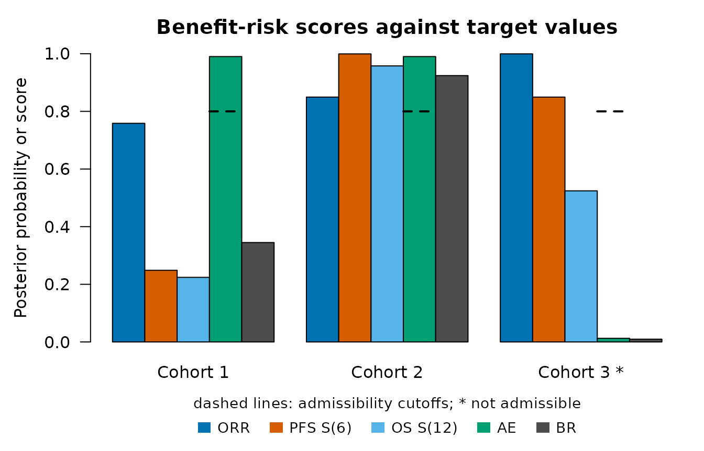
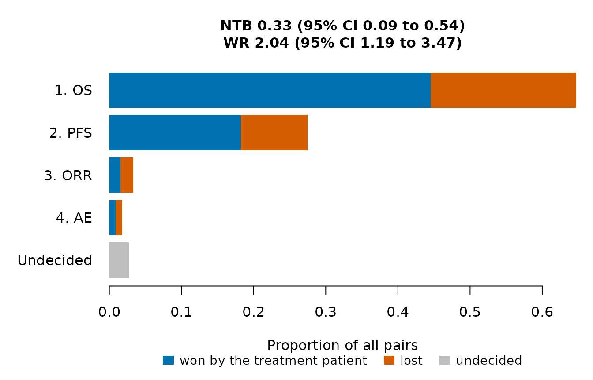
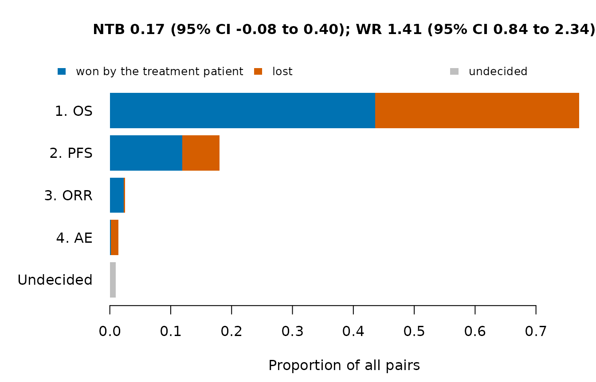

# Analyzing a completed trial

``` r

library(OncoCohortSelect)
```

This article analyzes the data of a completed trial with three
single-arm cohorts, with column names in the style of ADaM data sets.
The data are fictitious and are installed with the package.

## Data

The file has one row per patient: the cohort (`TRT01P`), the overall and
progression-free survival times in months (`OSAVAL`, `PFSAVAL`) with
their censoring indicators (`OSCNSR`, `PFSCNSR`; 0 for an event and 1
for a censored time, as in ADaM), the best overall response (`BOR`) and
a flag for an adverse event of interest (`AEFL`, `"Y"` or blank).

``` r

path <- system.file("extdata", "example_trial.csv", package = "OncoCohortSelect")
adsl <- read.csv(path, stringsAsFactors = FALSE)
head(adsl)
#>   USUBJID   TRT01P OSAVAL OSCNSR PFSAVAL PFSCNSR BOR AEFL
#> 1  C1-001 Cohort 1  20.60      1   20.60       1  PR     
#> 2  C1-002 Cohort 1  22.88      1   10.77       0  PR     
#> 3  C1-003 Cohort 1  20.43      1   19.64       0  PR     
#> 4  C1-004 Cohort 1  11.87      0   11.87       0  PR     
#> 5  C1-005 Cohort 1  23.16      1   16.84       0  SD    Y
#> 6  C1-006 Cohort 1  12.31      1    2.98       0  SD
table(adsl$TRT01P, adsl$BOR)
#>           
#>            CR NE PD PR SD
#>   Cohort 1  1  1  7 13 18
#>   Cohort 2  3  0  6 12 19
#>   Cohort 3  5  0  8 17 10
table(adsl$TRT01P, adsl$AEFL == "Y")
#>           
#>            FALSE TRUE
#>   Cohort 1    31    9
#>   Cohort 2    31    9
#>   Cohort 3    17   23
```

## Endpoints

[`Endpoint()`](https://gosukehommaEX.github.io/OncoCohortSelect/reference/Endpoint.md)
names the columns of each endpoint. For a time-to-event endpoint,
`censor` gives a censoring indicator coded as in ADaM (0 for an event,
any other value for a censored time) and `event` an event indicator (1
for an event). For a binary endpoint, `positive` lists the values that
count as 1, here a complete or partial response and the flag `"Y"`.

``` r

eps <- list(
  Endpoint("OS", "tte", time = "OSAVAL", censor = "OSCNSR"),
  Endpoint("PFS", "tte", time = "PFSAVAL", censor = "PFSCNSR"),
  Endpoint("ORR", "binary", var = "BOR", positive = c("CR", "PR")),
  Endpoint("AE", "binary", var = "AEFL", positive = "Y", higher.better = FALSE))
```

In ADaM, time-to-event data are usually in a separate data set with one
row per patient and parameter.
[`reshape()`](https://rdrr.io/r/stats/reshape.html) puts the parameters
side by side, and [`merge()`](https://rdrr.io/r/base/merge.html) adds
them to the data of the patients:

``` r

adtte <- data.frame(USUBJID = c("01", "01", "02", "02"),
                    PARAMCD = c("OS", "PFS", "OS", "PFS"),
                    AVAL = c(10.2, 5.1, 8.4, 8.4), CNSR = c(1, 0, 0, 0))
reshape(adtte, idvar = "USUBJID", timevar = "PARAMCD", direction = "wide")
#>   USUBJID AVAL.OS CNSR.OS AVAL.PFS CNSR.PFS
#> 1      01    10.2       1      5.1        0
#> 3      02     8.4       0      8.4        0
```

The columns `AVAL.OS` and `CNSR.OS` are then given to
[`Endpoint()`](https://gosukehommaEX.github.io/OncoCohortSelect/reference/Endpoint.md).

## Benefit-risk scores

Against target values, with the criteria of the article *Evaluating
decision rules by simulation*:

``` r

crit <- data.frame(endpoint = c("ORR", "PFS", "OS", "AE"),
                   target = c(0.30, 0.50, 0.60, 0.40), time = c(NA, 6, 12, NA),
                   weight = c(1 / 3, 1 / 3, 1 / 3, 1), cutoff = c(NA, NA, NA, 0.8))
br <- BenefitRisk(adsl, eps, crit, group = "TRT01P")
br
#> Posterior benefit-risk scores against target values
#> 
#>  component definition      weight cutoff
#>  ORR       P(rate >= 0.3)  0.333        
#>  PFS_S6    P(S(6) >= 0.5)  0.333        
#>  OS_S12    P(S(12) >= 0.6) 0.333        
#>  AE        P(rate <= 0.4)  1      0.8   
#> 
#>     group   ORR PFS_S6 OS_S12     AE admissible     BR selected
#>  Cohort 1 0.759  0.249  0.224 0.9901       TRUE 0.3450    FALSE
#>  Cohort 2 0.850  0.999  0.958 0.9901       TRUE 0.9241     TRUE
#>  Cohort 3 1.000  0.849  0.524 0.0127      FALSE 0.0097    FALSE
#> 
#> Selected: Cohort 2
plot(br)
```



Relative to Cohort 1, the reference regimen:

``` r

crit_ref <- data.frame(endpoint = c("ORR", "PFS", "OS", "AE"),
                       measure = c("rate", "hr", "hr", "rate"),
                       target = c(0.10, 0.80, 0.90, 0.10),
                       weight = c(1 / 3, 1 / 3, 1 / 3, 1), cutoff = c(NA, NA, NA, 0.8))
br_ref <- BenefitRisk(adsl, eps, crit_ref, group = "TRT01P", reference = "Cohort 1")
br_ref
#> Posterior benefit-risk scores relative to Cohort 1
#> 
#>  component definition                      weight cutoff
#>  ORR       P(rate - reference rate >= 0.1) 0.333        
#>  PFS_HR    P(HR <= 0.8)                    0.333        
#>  OS_HR     P(HR <= 0.9)                    0.333        
#>  AE        P(rate - reference rate <= 0.1) 1      0.8   
#> 
#>     group reference   ORR PFS_HR OS_HR     AE admissible      BR
#>  Cohort 2  Cohort 1 0.237  0.964 0.925 0.8621       TRUE 0.51373
#>  Cohort 3  Cohort 1 0.814  0.617 0.589 0.0103      FALSE 0.00686
plot(br_ref)
```


## Win statistics

Each new cohort is compared with Cohort 1, with priority OS, PFS,
response and adverse event.

``` r

w2 <- WinStat(adsl, eps, treatment = "Cohort 2", control = "Cohort 1", group = "TRT01P")
w3 <- WinStat(adsl, eps, treatment = "Cohort 3", control = "Cohort 1", group = "TRT01P")
w2
#> Generalized pairwise comparisons: Cohort 2 (treatment) vs Cohort 1 (control)
#> Patients: 40 and 40 (1600 pairs); scoring rule of Gehan
#> 
#> Proportions of all pairs won, lost and still undecided by priority level:
#>  priority endpoint threshold     win    loss undecided
#>         1       OS         0 0.44562 0.20125    0.3531
#>         2      PFS         0 0.18250 0.09250    0.0781
#>         3      ORR         0 0.01562 0.01750    0.0450
#>         4       AE         0 0.00875 0.00937    0.0269
#> 
#> Pairs won 0.652, lost 0.321, tied 0.0269
#> 
#> 95% confidence intervals:
#>  statistic estimate    se  lower upper
#>        NTB    0.332 0.118 0.0857  0.54
#>         WR    2.035 0.554 1.1940  3.47
#>         WO    1.993 0.527 1.1874  3.35
plot(w2)
```



``` r

plot(w3)
```



The net treatment benefit against Cohort 1 is 0.33 for Cohort 2 and 0.17
for Cohort 3. With the scoring rule of Péron, censored pairs are scored
with the Kaplan-Meier estimates:

``` r

rbind(
  "Cohort 2" = WinStat(adsl, eps, treatment = "Cohort 2", control = "Cohort 1",
                       group = "TRT01P", scoring = "peron")$estimate,
  "Cohort 3" = WinStat(adsl, eps, treatment = "Cohort 3", control = "Cohort 1",
                       group = "TRT01P", scoring = "peron")$estimate)
#>              p_win    p_loss       p_tie       ntb       wr       wo
#> Cohort 2 0.6273485 0.3676415 0.005010019 0.2597070 1.706414 1.701633
#> Cohort 3 0.5740167 0.4206718 0.005311524 0.1533449 1.364524 1.362237
```

## Applying a decision rule

The decision rule and its threshold are fixed when the trial is
designed, for example with
[`CalibrateThreshold()`](https://gosukehommaEX.github.io/OncoCohortSelect/reference/CalibrateThreshold.md)
as in the article *Evaluating decision rules by simulation*.
[`SimSelection()`](https://gosukehommaEX.github.io/OncoCohortSelect/reference/SimSelection.md)
computes all the statistics of a completed trial when the data are
treated as one simulated trial, and
[`SelectionOC()`](https://gosukehommaEX.github.io/OncoCohortSelect/reference/SelectionOC.md)
then gives a probability of 1 to the cohort that the rule selects. The
thresholds below are for illustration only.

``` r

adsl$sim <- 1
res <- SimSelection(adsl, eps, crit, reference = "Cohort 1", criteria.ref = crit_ref,
                    group = "TRT01P")
res[, c("group", "br", "adm", "br_diff", "br_ref", "adm_ref", "ntb", "wr")]
#>     group     br   adm br_diff  br_ref adm_ref   ntb   wr
#>  Cohort 1 0.3450  TRUE      NA      NA      NA    NA   NA
#>  Cohort 2 0.9241  TRUE   0.579 0.51373    TRUE 0.332 2.04
#>  Cohort 3 0.0097 FALSE  -0.335 0.00686   FALSE 0.167 1.41
rules <- data.frame(statistic = c("br_diff", "br_ref", "ntb", "wr"),
                    threshold = c(0.05, 0.5, 0.1, 1.5))
sel <- vapply(seq_len(nrow(rules)), function(i) {
  oc <- SelectionOC(res, rules$statistic[i], threshold = rules$threshold[i])
  oc$group[oc$p_select == 1]
}, character(1))
data.frame(rules, selected = sel)
#>   statistic threshold selected
#> 1   br_diff      0.05 Cohort 2
#> 2    br_ref      0.50 Cohort 2
#> 3       ntb      0.10 Cohort 2
#> 4        wr      1.50 Cohort 2
```

## Note

The data of this article are invented for illustration. They are
generated by the script `data-raw/make_example_trial.py` of the GitHub
repository of the package.
