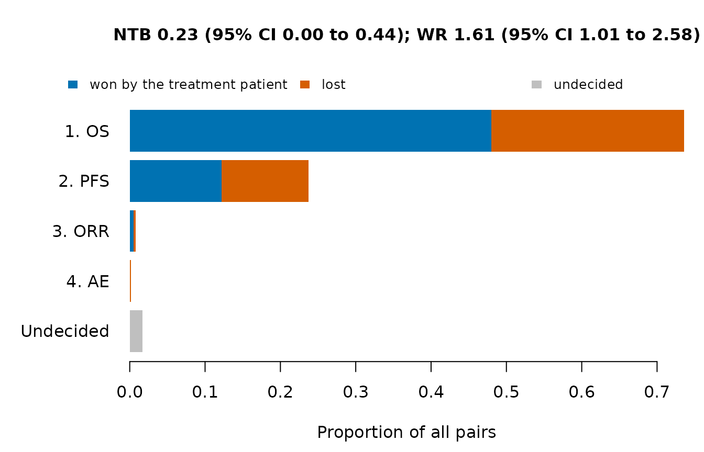

# Getting started with OncoCohortSelect

``` r

library(OncoCohortSelect)
```

OncoCohortSelect helps to choose one of several single-arm cohorts
studied in parallel, for example combination regimens in the cohorts of
a phase 2 trial, with several efficacy and safety endpoints. The cohorts
are compared by two approaches:

- a posterior benefit-risk score (Chakraborty et al., 2026), computed
  for each cohort against target values or for a cohort relative to a
  reference cohort, and
- generalized pairwise comparisons of prioritized endpoints (Buyse,
  2010), which give the net treatment benefit, the win ratio and the win
  odds of a cohort against a reference cohort.

The same functions analyze the data of a completed trial and of
simulated trials, so that a decision rule can be evaluated by simulation
before the trial and applied to its data afterwards.

## A first example

[`SimCohorts()`](https://gosukehommaEX.github.io/OncoCohortSelect/reference/SimCohorts.md)
simulates cohorts with correlated progression-free survival (PFS),
overall survival (OS) and objective response, generated by the
CorOncoEndpoints package, and an adverse event. Here one trial with two
cohorts of 50 patients is analyzed at month 24.

``` r

arms <- list(
  Cohort1 = CorOncoEndpoints::OncoArm(pfs.median = 6, orr = 0.30, resp.cor = 0.4,
                                      death.prop = 0.15, os.median = 15),
  Cohort2 = CorOncoEndpoints::OncoArm(pfs.median = 8, orr = 0.45, resp.cor = 0.4,
                                      death.prop = 0.15, os.median = 18))
d <- SimCohorts(nsim = 1, n = c(50, 50), arms = arms, ae.rate = c(0.20, 0.35),
                cutoff = 24, a.time = c(0, 12), seed = 1)
head(d)
#>   sim   group accrual_time   pfs_tte pfs_event    os_tte os_event response ae
#> 1   1 Cohort1     3.436951 18.123673         1 20.563049        0        0  0
#> 2   1 Cohort1    11.376369  7.577337         1 12.623631        0        0  0
#> 3   1 Cohort1     9.781919  1.107114         1  3.203035        1        0  0
#> 4   1 Cohort1     8.375189  4.197125         1  4.197125        1        0  0
#> 5   1 Cohort1    10.245421  2.699816         1 10.090377        1        0  0
#> 6   1 Cohort1    10.204578  7.689206         1 13.795422        0        1  1
```

Endpoints are defined by the columns that hold them and by their
favorable direction; any number of binary and time-to-event endpoints
can be used.

``` r

eps <- list(
  Endpoint("OS", "tte", time = "os_tte", event = "os_event"),
  Endpoint("PFS", "tte", time = "pfs_tte", event = "pfs_event"),
  Endpoint("ORR", "binary", var = "response"),
  Endpoint("AE", "binary", var = "ae", higher.better = FALSE))
```

The benefit-risk score of each cohort against target values combines the
posterior probabilities that the response rate is at least 0.3, that the
PFS and OS probabilities at months 6 and 12 are at least 0.5 and 0.6,
and that the adverse event rate is at most 0.3.

``` r

crit <- data.frame(endpoint = c("ORR", "PFS", "OS", "AE"),
                   target = c(0.30, 0.50, 0.60, 0.30), time = c(NA, 6, 12, NA))
BenefitRisk(d, eps, crit)
#> Posterior benefit-risk scores against target values
#> 
#>  component definition      weight cutoff
#>  ORR       P(rate >= 0.3)  0.25         
#>  PFS_S6    P(S(6) >= 0.5)  0.25         
#>  OS_S12    P(S(12) >= 0.6) 0.25         
#>  AE        P(rate <= 0.3)  0.25         
#> 
#>    group  ORR PFS_S6 OS_S12    AE admissible    BR selected
#>  Cohort1 0.89  0.216  0.184 0.999       TRUE 0.434    FALSE
#>  Cohort2 1.00  0.952  0.907 0.943       TRUE 0.950     TRUE
#> 
#> Selected: Cohort2
```

The pairwise comparisons of Cohort2 against Cohort1 use the priority
order OS, PFS, response and adverse event.

``` r

w <- WinStat(d, eps, treatment = "Cohort2", control = "Cohort1")
w
#> Generalized pairwise comparisons: Cohort2 (treatment) vs Cohort1 (control)
#> Patients: 50 and 50 (2500 pairs); scoring rule of Gehan
#> 
#> Proportions of all pairs won, lost and still undecided by priority level:
#>  priority endpoint threshold    win   loss undecided
#>         1       OS         0 0.4800 0.2556    0.2644
#>         2      PFS         0 0.1216 0.1160    0.0268
#>         3      ORR         0 0.0048 0.0032    0.0188
#>         4       AE         0 0.0000 0.0016    0.0172
#> 
#> Pairs won 0.606, lost 0.376, tied 0.0172
#> 
#> 95% confidence intervals:
#>  statistic estimate    se   lower upper
#>        NTB     0.23 0.112 0.00225 0.435
#>         WR     1.61 0.388 1.00522 2.582
#>         WO     1.60 0.378 1.00452 2.540
```

The net treatment benefit of Cohort2 is 0.23 and its win ratio 1.61. The
results of
[`BenefitRisk()`](https://gosukehommaEX.github.io/OncoCohortSelect/reference/BenefitRisk.md),
[`WinStat()`](https://gosukehommaEX.github.io/OncoCohortSelect/reference/WinStat.md),
[`SimSelection()`](https://gosukehommaEX.github.io/OncoCohortSelect/reference/SimSelection.md)
and
[`SelectionOC()`](https://gosukehommaEX.github.io/OncoCohortSelect/reference/SelectionOC.md)
have [`print()`](https://rdrr.io/r/base/print.html) and
[`plot()`](https://rdrr.io/r/graphics/plot.default.html) methods; the
plot of the win statistics shows how many pairs each endpoint decides.

``` r

plot(w)
```



## Where to go next

- *Posterior benefit-risk score*: the models, the components against
  target values and relative to a reference cohort, weights and
  admissibility.
- *Net benefit and win ratio*: priority, thresholds, the scoring rules
  of Gehan and of Péron, and the confidence intervals.
- *Evaluating decision rules by simulation*: selecting one of three
  cohorts and comparing rules at a common probability of a false
  selection.
- *Analyzing a completed trial*: data in the style of ADaM data sets and
  the decision at the end of the trial.

## References

Buyse, M. (2010). Generalized pairwise comparisons of prioritized
outcomes in the two-sample problem. *Statistics in Medicine*, 29,
3245-3257. <https://doi.org/10.1002/sim.3923>

Chakraborty, S., Dubey, A. K., Kumar, A. and Chan, I. (2026). A
two-stage dose optimization framework for oncology drug development with
multiple efficacy and safety endpoints via an integrated benefit-risk
assessment. *Statistics in Biopharmaceutical Research*, published
online. <https://doi.org/10.1080/19466315.2026.2668381>
